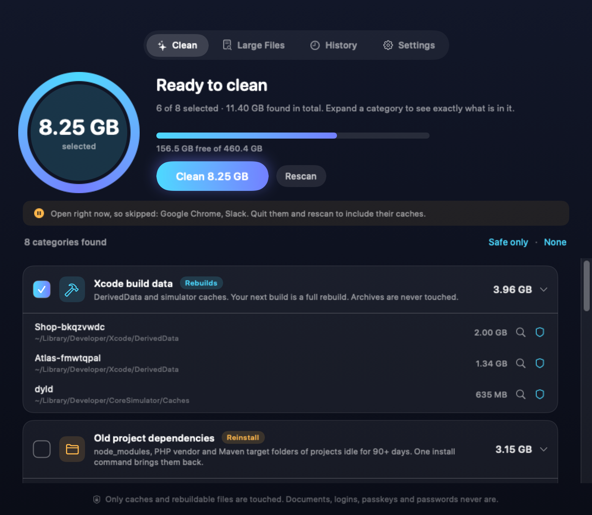
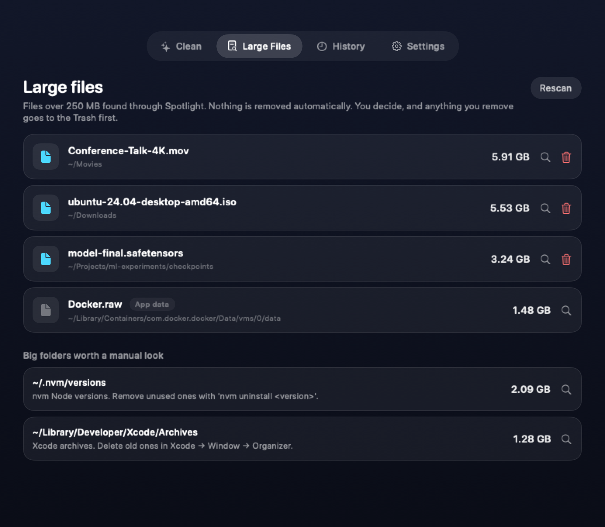
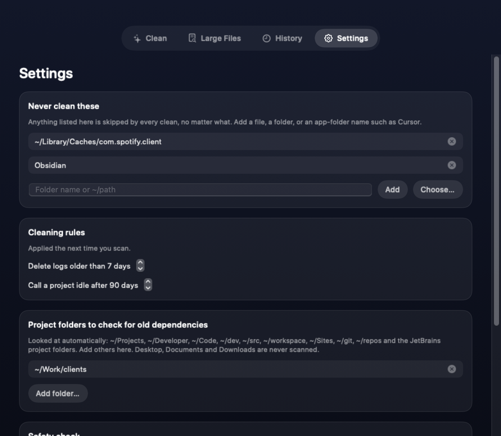
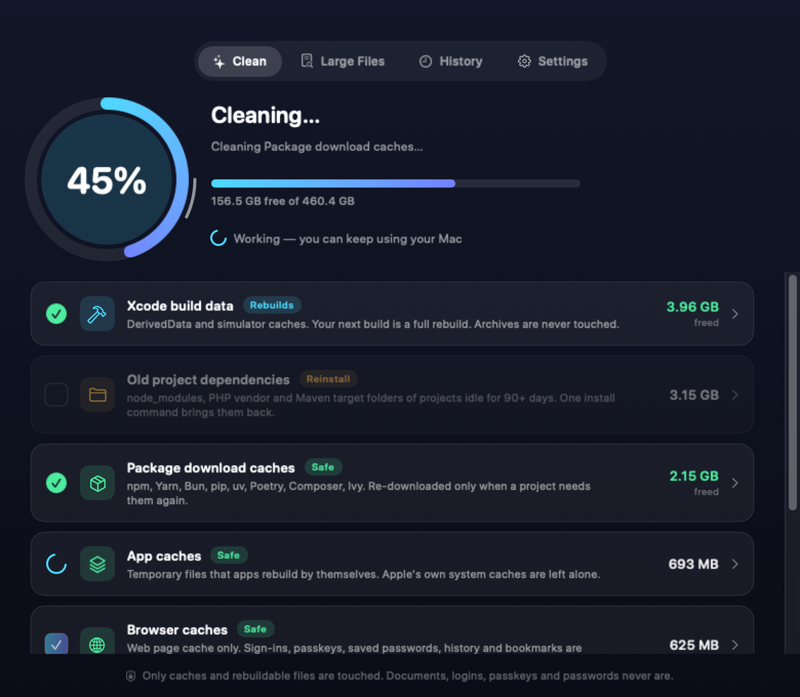
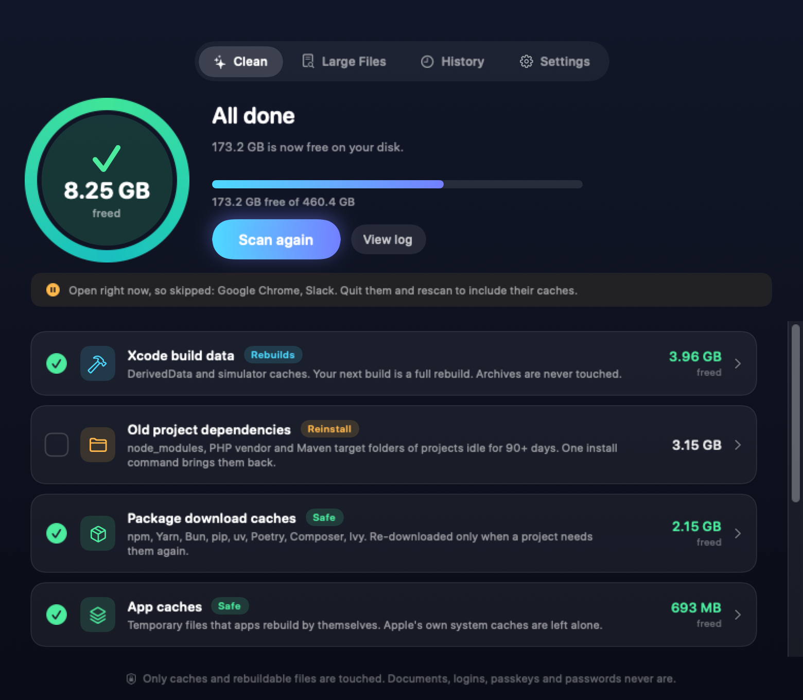

<div align="center">


# Wisp

**The safe, one-click deep clean for developer Macs.**

Scans first, shows you exactly what it found, and only removes what can be rebuilt.
Your files, browser logins, passkeys and passwords are never touched.

[](https://github.com/karanzykx/wisp/actions/workflows/ci.yml)
[](https://github.com/karanzykx/wisp/releases/latest)
[](LICENSE)


[**Download Wisp.dmg**](https://github.com/karanzykx/wisp/releases/latest/download/Wisp.dmg) ·
[Homebrew](#install) · [How it stays safe](docs/SAFETY.md) · [How it works](docs/HOW_IT_WORKS.md) ·
[Changelog](CHANGELOG.md) · [Roadmap](#roadmap)

> **Status: preview release (v0.1.0).** Wisp is tested and usable, but it is early: behaviour can still change between
> 0.x versions, and the app is not notarised by Apple. New versions are small and numbered; what is planned next is
> in the [Roadmap](#roadmap). Ideas and bug reports are very welcome.

<br>



</div>

## Why Wisp

Developer Macs fill up with things that are safe to delete but scattered everywhere: Xcode DerivedData, package
manager downloads, Homebrew leftovers, `node_modules` from projects you finished a year ago, editor and browser caches.
General-purpose cleaners either miss most of it, or delete things they should not.

Wisp is built around one rule: **only data that can be rebuilt is ever removed, and every removal goes through a guard
that refuses anything else.**

- **Preview first.** A scan lists every category with its size. Expand one to see the exact folders in it.
- **You choose.** Untick anything. Risky categories are off by default and ask for confirmation.
- **Protects your logins.** Browser profiles (cookies, saved passwords, passkeys, extensions) are refused outright.
  Only the web *cache* is cleaned, and only when the browser is closed.
- **Leaves running apps alone.** Anything a process has open, and every app that is running, is skipped.
- **Open source and testable.** The cleaner is one readable shell script with an end-to-end test suite
  and a built-in self-test you can run on your own Mac.

## Install

### Homebrew

```bash
brew install --cask karanzykx/tap/wisp
```

This installs `Wisp.app` and also puts a `wisp` command on your `PATH` for the terminal.
Update with `brew upgrade --cask wisp`, remove with `brew uninstall --zap --cask wisp`.

### Direct download

1. Download [**Wisp.dmg**](https://github.com/karanzykx/wisp/releases/latest/download/Wisp.dmg).
2. Open it and drag **Wisp** to **Applications**.
3. Launch it once. See [First launch](#first-launch) below.

Every release lists a SHA-256 checksum (`Wisp.dmg.sha256`). To verify a download:

```bash
cd ~/Downloads && shasum -a 256 -c Wisp.dmg.sha256
```

### First launch

Wisp is open source and **not notarised by Apple**, so macOS shows a
warning the first time you open a downloaded copy. This is expected. Approve it once:

- **macOS 15 (Sequoia) or later:** open Wisp, dismiss the warning, then go to
  **System Settings → Privacy & Security**, scroll down to *"Wisp" was blocked* and choose **Open Anyway**.
- **macOS 14 or earlier:** right-click (or Control-click) **Wisp** and choose **Open**.
- **Or in Terminal:** `xattr -dr com.apple.quarantine /Applications/Wisp.app`

The Homebrew cask removes that quarantine flag for you after verifying the download's SHA-256 checksum, so
`brew install` needs no extra step. You can read exactly what it does in the
[tap's cask file](https://github.com/karanzykx/homebrew-tap/blob/main/Casks/wisp.rb).

## Using the app

| Clean | Large Files | Settings |
|:--:|:--:|:--:|
|  |  |  |

1. Wisp **scans** when it opens. Nothing is deleted during a scan.
2. Review the list. Click a row to see exactly which folders are inside; click the shield on any folder to
   **never clean it**.
3. Press **Clean**. Rows show progress and what was freed. Every clean is added to **History**.

The **Large Files** tab lists files over 250 MB so you can decide what to do with them. Files in your own folders can be
moved to the Trash (recoverable with *Put Back*); app data is shown but never offered for removal.

<p align="center">
  &nbsp;&nbsp;
  
</p>

> The screenshots use sample data.

## What it cleans

| Category | What is removed | Default |
|---|---|:--:|
| Browser caches | Web page cache of Chrome, Edge, Brave, Firefox, Arc, Opera and Vivaldi (when closed) | on |
| App caches | `~/Library/Caches` of closed apps. Apple system caches are skipped | on |
| Editor and chat-app caches | `Cache`, `GPUCache`, `CachedData` and logs of VS Code, Cursor, Slack, Docker Desktop and similar | on |
| Old logs | User logs older than 7 days (configurable) | on |
| Xcode build data | DerivedData and simulator caches. **Archives are never touched** | on |
| Unavailable simulators | `xcrun simctl delete unavailable` | on |
| Package caches | npm, Yarn, Bun, pip, uv, Poetry, Composer and Ivy download caches; `pnpm store prune` | on |
| Developer tool caches | Caches of pre-commit, Zig, mise, rustup, kubectl and the Android SDK manager. Each rebuilds itself the next time the tool runs | on |
| Language package downloads | Downloaded packages for Dart/Flutter, Conda/Mamba, NuGet, Hex, Cabal, Terraform and minikube. Projects need an install or restore step again, such as `pub get` or `dotnet restore` | off |
| Homebrew | `brew cleanup --prune=all` (installed software stays) | on |
| Docker | Untagged images and build cache. **Volumes and containers are never touched** | on |
| Device support symbols | Xcode iOS/watchOS/tvOS symbols, re-created when you connect a device | off |
| Gradle and Cargo stores | Build dependency caches. The next build re-downloads them | off |
| Unused Homebrew dependencies | `brew autoremove`, listed for review first | off |
| Old project dependencies | `node_modules`, PHP `vendor`, Maven `target` in projects idle for 90+ days, only next to a manifest **and** lockfile | off |
| Empty the Trash | Permanent, so off by default | off |

## What it never touches

Documents, Desktop, Downloads, Photos, Mail, Messages and iCloud · Keychains, passkeys and saved passwords ·
browser profiles, cookies and sessions · SSH keys · app settings and preferences · iPhone backups · Xcode Archives ·
Docker volumes (your databases) · Python virtualenvs · JetBrains Local History · Time Machine.

The full list and how each rule is enforced is in [docs/SAFETY.md](docs/SAFETY.md).

## Command line

The engine is a standalone script. After `brew install --cask karanzykx/tap/wisp` it is available as `wisp`;
from a clone it is `engine/wisp.sh`.

```bash
wisp --dry-run          # preview everything, delete nothing
wisp                    # interactive: shows sizes, asks before each category
wisp --yes              # no prompts: safe defaults only
wisp --only browsers,pkgcaches,xcode   # clean just these categories
wisp --insights         # list large files and big folders worth a look
wisp --self-test        # prove the safety guards work on this Mac
wisp --help             # every option
```

## Configuration

Plain text files in `~/.config/wisp/` (the Settings tab edits these for you):

| File | Purpose |
|---|---|
| `keep.txt` | One path or folder name per line. Anything listed is **never** cleaned, e.g. `~/Library/Caches/com.spotify.client` or `Cursor` |
| `roots.txt` | Extra project folders (inside your home) to check for old `node_modules` / `vendor` / `target` |

Logs of every run are written to `~/Library/Logs/Wisp/`.

## Build from source

You only need the Xcode Command Line Tools (`xcode-select --install`).

```bash
git clone https://github.com/karanzykx/wisp.git
cd wisp
scripts/build.sh        # → dist/Wisp.app, dist/Wisp.dmg, dist/Wisp.dmg.sha256
```

Run the tests with `engine/wisp.sh --self-test` and `tests/e2e.sh`. See [CONTRIBUTING.md](CONTRIBUTING.md).

## FAQ

**Will it log me out of Chrome, Gmail or anything else?**
No. Wisp never opens, reads or deletes a browser profile; the files that hold your sign-ins, passkeys and saved
passwords are on its never-touch list and rejected by its guard. It only clears the cache folder, and skips a browser
that is running.

**Why did it skip some apps?**
Apps that are open are skipped so nothing is deleted from under them. Quit them and press *Rescan*.

**Is `--dry-run` really a dry run?**
Yes. Every deletion goes through three functions and each is a no-op in dry-run mode. The test suite checks this.

**Does it need admin rights?**
No. It never uses `sudo` unless you pass `--system` or `--maintenance` yourself on the command line. The app never does.

**Which Macs and macOS versions work?**
The app is a universal binary (Apple Silicon and Intel) built for macOS 11 and later. Automated tests run on
macOS 15 on Apple Silicon; older versions and Intel Macs should work but are not covered by CI. Please open an
issue if they do not.

## Roadmap

Wisp ships in small, clearly numbered versions, each listed in the [changelog](CHANGELOG.md). Versions below 1.0.0 are
previews: usable and tested, but still evolving. The plan is public, tracked in
[milestones](https://github.com/karanzykx/wisp/milestones), and open to suggestions; plans can change.

| Version | Focus |
|---|---|
| **0.1.0** (current) | First public preview: app, engine, safety checks, DMG download, Homebrew tap |
| **0.2.0** | More categories (JetBrains IDE caches without Local History, Android SDK and emulator caches, Flutter/Dart pub cache, Conda packages) and test reports from Intel Macs and macOS 11 to 14 |
| **0.3.0** | Scheduled, unattended cleans with a notification, and a clearer per-run report |
| **1.0.0** | Notarised app, stable safety rules, submission to official Homebrew |

Have an idea? [Start a discussion](https://github.com/karanzykx/wisp/discussions) or open a
[feature request](https://github.com/karanzykx/wisp/issues/new?template=feature_request.yml).

## Contributing and suggestions

Suggestions, bug reports and pull requests are welcome from everyone.

- **Suggest something:** [Discussions](https://github.com/karanzykx/wisp/discussions), or a feature request.
- **Report a bug:** use the [issue form](https://github.com/karanzykx/wisp/issues/new/choose).
- **Send code:** fork, branch, open a pull request. CI (lint, end-to-end tests, build) runs on every pull request.

**All changes are reviewed and merged by the maintainer only.** `main` is protected, requires passing checks, and nobody else
has write access. That is deliberate: Wisp deletes files, so every change to what can be removed gets a careful review.
Details, including how to add a category safely, are in [CONTRIBUTING.md](CONTRIBUTING.md). Security issues: see
[SECURITY.md](SECURITY.md).

## License

[MIT](LICENSE) © 2026 KzyKx9959
