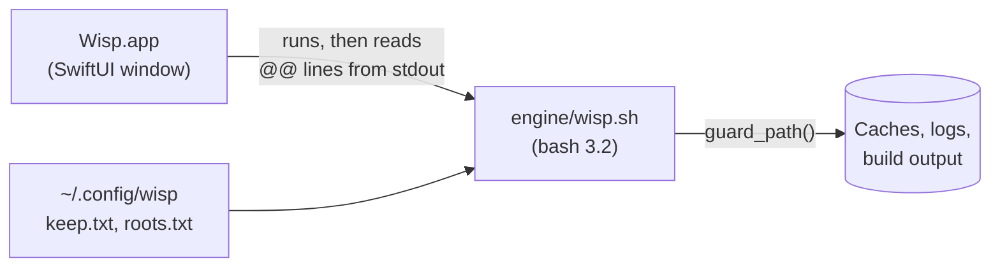

# How Wisp works

Wisp has two parts that talk through a tiny text protocol.



| Part | Where | Job |
|---|---|---|
| **Engine** | `engine/wisp.sh` | Finds candidates, decides what is allowed, deletes. Works on its own as a CLI |
| **App** | `app/Sources/` | Shows what the engine found, lets you choose, runs the engine again for exactly that choice |

The app contains **no deletion code**. That keeps every safety rule in one auditable file.

## A clean, step by step

1. **Scan.** The app runs `wisp --dry-run --yes --app --no-report`. The engine walks its categories and, for each one with
   something to clean, prints a `CAT` line and one `ITEM` line per folder. Because it is a dry run, nothing is changed.
2. **Choose.** The app lists the categories. Defaults come from the engine (`y` or `n` per category). You tick, untick and
   expand rows.
3. **Clean.** On *Clean*, the app runs `wisp --yes --app --no-report --only id1,id2,…` with exactly the ticked ids.
   Any category not named answers *no* to its own confirmation.
4. **Report.** The engine prints `CATDONE` per category and a final `RESULT` with the space freed and free space before
   and after. The app stores the run in History.

The scan and the clean are two separate processes that re-evaluate everything, so what is removed is decided by the
engine at that moment (for example, an app you opened in between is skipped), never by a stale list.

## Categories

Each category has a stable id used by `--only`.

| id | Description | Default |
|---|---|:--:|
| `browsers` | Browser web caches in `~/Library/Caches` (closed browsers only) | on |
| `appcaches` | Other `~/Library/Caches` folders (not `com.apple.*`) | on |
| `electron` | Cache folders of Electron/Chromium apps in Application Support | on |
| `logs` | `~/Library/Logs` files older than N days | on |
| `xcode` | DerivedData and simulator caches | on |
| `devsupport` | Xcode device-support symbols | off |
| `simulators` | `xcrun simctl delete unavailable` | on |
| `pkgcaches` | npm, Yarn, Bun, pip, uv, Poetry, Composer, Ivy caches | on |
| `pnpm` | `pnpm store prune` | on |
| `depstores` | Gradle caches and wrapper dists, Cargo registry | off |
| `devcaches` | Dart/Flutter `~/.pub-cache/hosted`, Conda/Mamba `pkgs` download cache | off |
| `brew` | `brew cleanup --prune=all` | on |
| `brewauto` | `brew autoremove`, with the list shown first | off |
| `docker` | Dangling images and build cache (never volumes) | on |
| `projdeps` | Old `node_modules`, `vendor`, `target` | off |
| `trash` | Empty the Trash via Finder | off |

## The `@@` protocol

With `--app` the engine prints machine-readable lines to stdout alongside its normal output. Each starts with `@@` and is
tab-separated. The app ignores every other line.

| Line | Fields | Meaning |
|---|---|---|
| `SECTION` | title | A new step started |
| `STEP` | n, total | Progress |
| `CAT` | id, title, risk, size_kb, default, sf_symbol, description | A category with something to clean. `size_kb` is `-1` when it runs a command instead of deleting listed files |
| `ITEM` | id, size_kb, path | One folder inside the most recent category |
| `BUSY` | names | Apps that were open, so their caches were skipped |
| `CATDONE` | id, freed_kb | A category finished |
| `RESULT` | `dry` or `done`, freed_kb, free_before_kb, free_after_kb | The run finished |
| `ERROR` | `busy` or `interrupted` | The run stopped |
| `BIG` | size_kb, `user` or `app`, path | `--insights`: a large file |
| `HINT` | size_kb, path, advice | `--insights`: a big folder worth a manual look |
| `DONE` | | `--insights` finished |

Try it: `engine/wisp.sh --dry-run --yes --app --no-report | grep '^@@'`.

## How "in use" is detected

At the start of each run the engine records every file currently open by your processes (`lsof`) and the bundle identifiers
and names of running apps (`lsappinfo`). A candidate is skipped when something is open under it, or when its folder name
belongs to a running app (for example `com.microsoft.VSCode` or `Slack`). Cache folder names that are not app names are
only counted, not shown.

## Repository layout

```
engine/wisp.sh        the cleaner: CLI, guard, categories, --self-test
app/Sources/          SwiftUI app (Engine.swift talks to the script, Views.swift is the UI)
scripts/build.sh      builds dist/Wisp.app and dist/Wisp.dmg (universal, signed ad hoc)
scripts/make_icon.swift   draws the app icon
tests/e2e.sh          end-to-end tests against a throwaway HOME
docs/                 this documentation and the README images
.github/workflows/    CI and the tag-triggered release
```

## Test hooks

These environment variables exist for tests and screenshots only.

| Variable | Effect |
|---|---|
| `WISP_SKIP_TOOLS=1` | Engine ignores `brew`, `docker`, `pnpm` and `mdfind` |
| `WISP_DEMO=ready\|cleaning\|done` | App shows built-in sample data and never runs the engine |
| `WISP_SNAPSHOT=/path.png` | App saves a 2x image of its window and quits; the Clean button is disabled |
